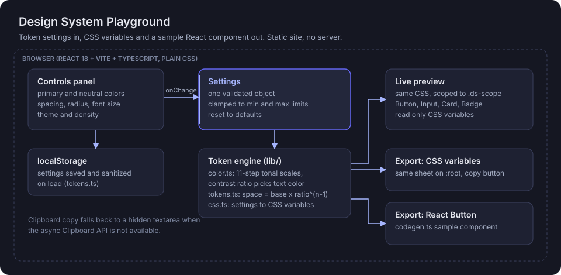

# Design System Playground

**Tune a handful of design tokens, see real components react instantly, then copy the CSS variables and a React component into your project.**

[](https://react.dev/)
[](https://www.typescriptlang.org/)
[](https://vite.dev/)
[](src/styles)
[](package.json)

**Live demo:** https://design-system-playground-two.vercel.app

> **Example:** pick `#0f766e` as the primary color, raise the radius to 14 and switch to compact density. Every Button, Input, Card and Badge in the preview updates at once, the text on filled buttons flips to whichever of light or dark reads better, and the export panel shows the exact `:root` variables to paste into your app.


## Architecture



A static single-page app. There is no server, no network call and no account.

## How it works

1. **One settings object.** `tokens.ts` defines the settings (primary, neutral, spacing base and ratio, radius, font size, theme, density), their defaults and their min and max limits. `sanitizeSettings` validates anything read back from `localStorage`, so bad stored data falls back to defaults.
2. **Color engine.** `color.ts` converts hex and HSL and builds an 11-step tonal scale (50 to 950) anchored on the picked color. `contrastRatio` uses the WCAG luminance formula, and `readableOn` picks the more readable of two text colors for each filled surface.
3. **Spacing and type.** Spacing follows `space-n = base x ratio^(n-1)` over 8 steps. Radius and font size derive `sm`, `md` and `lg` variants.
4. **CSS generation.** `css.ts` turns settings into one CSS variable sheet: scales, semantic tokens per theme (`--bg`, `--surface`, `--text`, `--primary`, `--danger` and more), spacing, radius, type and a density multiplier.
5. **What you see is what you copy.** The preview applies that sheet scoped to `.ds-scope`, and the export panel shows the same sheet on `:root`. The UI components (`src/components/ui`) read only these variables.
6. **Code export.** `codegen.ts` writes a sample React `Button` that uses the variables. Both panels copy to the clipboard, with a hidden textarea fallback when the async Clipboard API is missing.

## Run locally

Requires Node.js 18 or newer.

```bash
npm install
npm run dev         # http://localhost:5173
npm run build       # type-check, then build to dist/
```

No environment variables are needed, so there is no `.env.example`.

## Evaluation

There is no automated test suite yet. `npm run build` runs `tsc --noEmit` in strict mode first. The contrast helper follows the WCAG 2 formula, but the app does not report a pass or fail per token pair; that would be a good first test target.

## Honest limitations

- A personal portfolio prototype with no real users.
- Four components only (Button, Input, Card, Badge). No layout, form or navigation patterns.
- Exports CSS variables and one React sample. No design token JSON (for example W3C format), Figma sync or Tailwind config.
- Contrast is used to pick text color, not to warn when a chosen palette fails WCAG AA.
- Settings live in one browser's `localStorage`; there is no sharing or versioning.
- No automated tests.

## Stack

React 18, TypeScript 5 (strict), Vite 5, plain CSS with custom properties, browser `localStorage`. Runtime dependencies are `react` and `react-dom` only.

Part of the Lab at https://www.abhidattasrichandan.com
