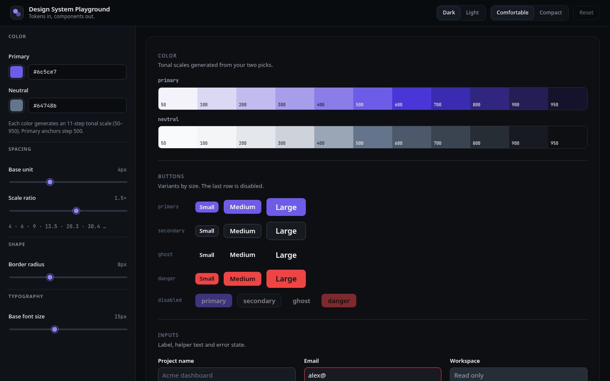

# Design System Playground

An interactive playground for designing a token-driven UI kit in the browser. Pick a primary and neutral color, tune the spacing scale, radius and type size, and watch a live component preview update instantly. When it feels right, copy the generated CSS variables and a sample React component straight into your project.



> Screenshot lives at `docs/screenshot.png`. Replace it with a fresh capture whenever the UI changes.

## Live Demo

**https://design-system-playground.vercel.app** _(placeholder: update this link after the first Vercel deploy)_

The source repository is private; the demo is public.

## Features

- **Live token controls**
  - Primary and neutral color pickers (with hex input) that each generate an 11-step tonal scale (50 to 950)
  - Spacing scale from a base unit and a ratio (`space-n = base × ratio^(n-1)`)
  - Border radius and base font size, with derived `sm / md / lg` and type-scale tokens
- **Live component preview**: Button (primary, secondary, ghost, danger; sm, md, lg; disabled), Input (label, helper text, error, disabled), Card, Badge (neutral, primary, success, warning, danger). Every component reads only from generated CSS variables.
- **Theme toggle** (dark by default, light) and **density toggle** (comfortable, compact)
- **Export panels** for the generated CSS variables and a sample React `Button`, each with a copy button, "Copied" feedback and a fallback for browsers without the Clipboard API
- **Reset to defaults**, and **settings persisted** to `localStorage`
- Accessible by default: labelled controls, radio-group toggles, visible focus rings, live-region copy announcements, reduced-motion support
- Responsive layout: sidebar and canvas on desktop, stacked on small screens
- Zero runtime dependencies beyond React, plain CSS with variables

## Getting started

Requires Node.js 18 or newer.

```bash
npm install
npm run dev
```

Then open the URL Vite prints (usually http://localhost:5173).

## Scripts

| Script              | Description                                  |
| ------------------- | -------------------------------------------- |
| `npm run dev`       | Start the Vite dev server                    |
| `npm run build`     | Type-check (`tsc --noEmit`) and build to `dist/` |
| `npm run preview`   | Serve the production build locally           |
| `npm run typecheck` | Type-check only                              |

## Project structure

```
.
├── docs/                    # Screenshot for this README
├── public/                  # Static assets (favicon)
├── src/
│   ├── components/
│   │   ├── code/            # CodePanel (copy button + feedback)
│   │   ├── controls/        # ColorField, RangeField, SegmentedControl, ControlsPanel
│   │   ├── layout/          # TopBar (theme, density, reset)
│   │   ├── preview/         # Preview canvas, sections, tonal scale strips
│   │   └── ui/              # Button, Input, Card, Badge (the system under test)
│   ├── hooks/               # useSettings, useLocalStorage, useClipboard
│   ├── lib/
│   │   ├── color.ts         # hex/HSL conversion, tonal scales, contrast helpers
│   │   ├── tokens.ts        # Settings type, defaults, limits, validation
│   │   ├── css.ts           # Settings -> CSS variable sheet
│   │   └── codegen.ts       # Settings -> sample React component
│   ├── styles/              # base, app shell, controls, code panels, ds components, preview
│   ├── App.tsx
│   └── main.tsx
├── index.html
├── vite.config.ts
└── tsconfig.json
```

## How it works

`src/lib/css.ts` turns the current settings into a CSS variable sheet: color scales, semantic tokens per theme (`--bg`, `--surface`, `--text`, `--primary`, `--danger`, and so on), spacing, radius, type sizes and a `--density` multiplier. The preview canvas applies that exact sheet scoped to `.ds-scope`, and the export panel shows it on `:root`, so what you see is what you copy. Foreground colors on filled buttons are chosen automatically for contrast.

## Deploy notes

The project is a static Vite build, so any static host works. On Vercel:

1. Push this repository to GitHub (private is fine).
2. Import it at https://vercel.com/new. Vercel detects Vite: build command `npm run build`, output directory `dist`.
3. Deploy. Every push to `main` redeploys automatically.
4. Put the resulting `*.vercel.app` URL in the **Live Demo** section above.

No environment variables are required.

## License

Personal portfolio project. All rights reserved unless a license is added.
